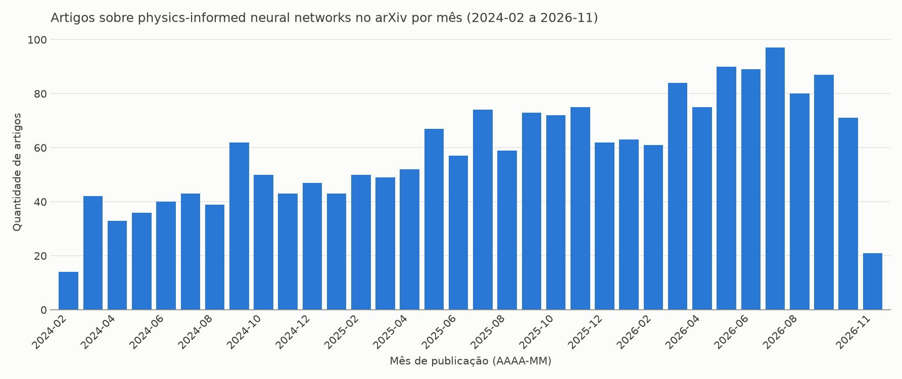

# Coletor de artigos sobre PINNs

Scripts em Python que coletam metadados de artigos sobre *physics-informed neural networks* (PINNs) na [API pública do arXiv](https://info.arxiv.org/help/api/index.html) e mostram quantos artigos foram publicados por mês.

## Como funciona

**Coleta** (`coletor_artigos_pinn.py`)

1. Busca a frase exata "physics informed neural network", dos artigos mais recentes para os mais antigos.
2. Pede 50 artigos por requisição, com 3 segundos de pausa entre elas, como o arXiv recomenda.
3. Descarta duplicatas pelo link e salva o resultado em `artigos_pinn_arxiv.csv`.

**Tendência** (`grafico_tendencia.py`)

1. Lê o CSV e conta os artigos de cada mês. Meses sem publicações aparecem com 0.
2. Mostra a contagem no terminal e salva um gráfico de barras em `tendencia_artigos_por_mes.png`.

## Requisitos

- Python 3.11 ou superior
- Acesso à internet (só para a coleta)

## Instalação

```bash
git clone https://github.com/<seu-usuario>/<repositorio>.git
cd <repositorio>

python -m venv .venv
.venv\Scripts\activate        # Windows
# source .venv/bin/activate   # Linux ou macOS

pip install -r requirements.txt
```

## Uso

```bash
python coletor_artigos_pinn.py   # Coleta os artigos (cerca de 2 minutos)
python grafico_tendencia.py      # Gera a contagem mensal e o gráfico
```

A coleta substitui o CSV a cada execução. Como começa pelos artigos mais recentes, o resultado muda com o tempo.

Saída do gráfico no terminal (trecho):

```text
Artigos por mês:
Mês      Artigos
2024-02       14
2024-03       42
...
2026-10       71
2026-11       21
Total       2000
```

> O primeiro e o último mês costumam estar incompletos: a coleta para no meio de um mês e o mês atual ainda não terminou. Desconsidere essas pontas ao interpretar a tendência.

## Resultado

O `artigos_pinn_arxiv.csv` do repositório é uma coleta de exemplo com 2000 artigos, publicados de fevereiro de 2024 a novembro de 2026. O gráfico gerado a partir dela mostra o número de publicações mensais saindo de cerca de 40 em 2024 e chegando perto de 90 em meados de 2026.



Colunas do CSV:

| Coluna | Descrição | Exemplo |
| --- | --- | --- |
| `titulo` | Título do artigo | `Fractional physics-informed neural networks to model social media virality` |
| `autores` | Autores separados por `; ` | `Alex Koong; George Em Karniadakis` |
| `data_publicacao` | Data da primeira versão (AAAA-MM-DD) | `2026-11-04` |
| `link` | Página do artigo no arXiv | `http://arxiv.org/abs/2611.07215v1` |

O arquivo usa UTF-8 com BOM para que os acentos apareçam corretamente no Excel.

## Configuração

Os parâmetros ficam no início de cada script.

[`coletor_artigos_pinn.py`](coletor_artigos_pinn.py):

| Constante | Padrão | Função |
| --- | --- | --- |
| `TERMO_BUSCA` | `"physics-informed neural network"` | Frase pesquisada |
| `TOTAL_DESEJADO` | `2000` | Limite de artigos a coletar |
| `POR_PAGINA` | `50` | Artigos por requisição |
| `PAUSA_SEGUNDOS` | `3` | Intervalo entre requisições |
| `ARQUIVO_CSV` | `"artigos_pinn_arxiv.csv"` | Arquivo de saída |

Com 100 artigos, a coleta cobre poucas semanas. O limite de 2000 abrange vários meses, o que basta para mostrar uma tendência.

[`grafico_tendencia.py`](grafico_tendencia.py):

| Constante | Padrão | Função |
| --- | --- | --- |
| `ARQUIVO_CSV` | `"artigos_pinn_arxiv.csv"` | Arquivo lido |
| `ARQUIVO_GRAFICO` | `"tendencia_artigos_por_mes.png"` | Imagem gerada |
| `MAX_ROTULOS_X` | `24` | Máximo de meses rotulados no eixo X |

## Estrutura

```text
.
├── coletor_artigos_pinn.py        # Coleta dos artigos
├── grafico_tendencia.py           # Contagem mensal e gráfico
├── artigos_pinn_arxiv.csv         # Exemplo de coleta
├── tendencia_artigos_por_mes.png  # Gráfico gerado
├── requirements.txt               # Dependências
├── README.md
└── LICENSE
```

## Dados

Os metadados vêm do arXiv. Consulte os [termos de uso da API](https://info.arxiv.org/help/api/tou.html) antes de ampliar a coleta.

## Agradecimentos

Thank you to arXiv for use of its open access interoperability.

*Agradecemos ao arXiv pelo uso de sua interoperabilidade de acesso aberto.*

## Licença

Distribuído sob a licença MIT. Consulte o arquivo [LICENSE](LICENSE).
